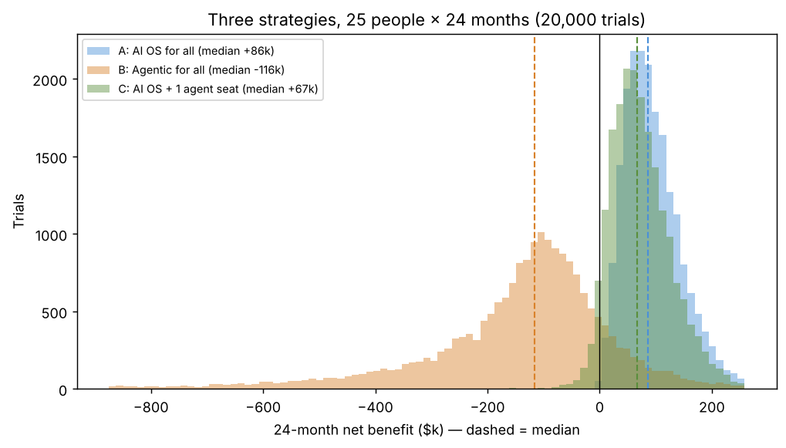
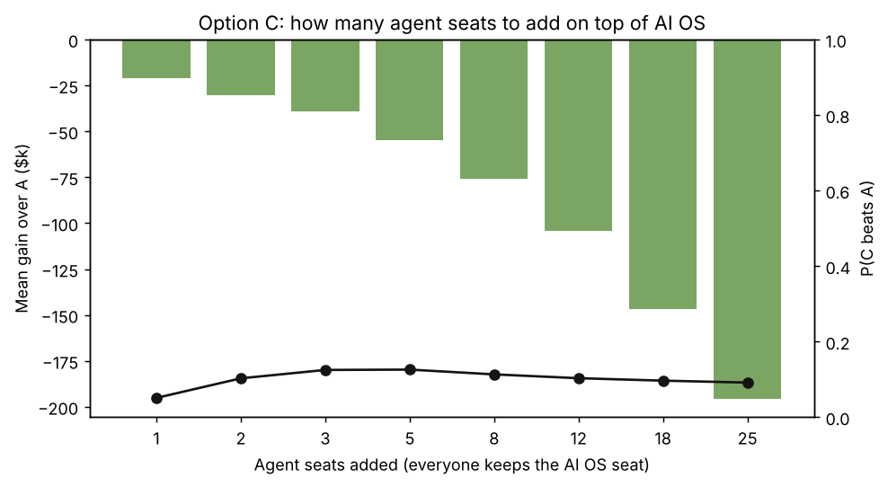
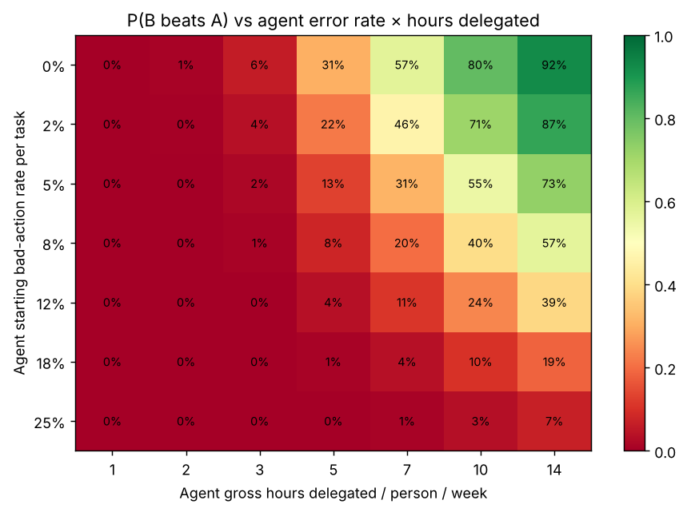
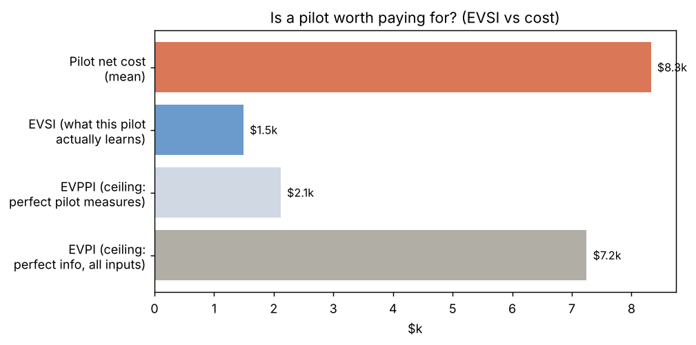

# Agentic OS vs AI OS — Monte Carlo trade-off (25 people × 24 months) · v3

**Bottom line:** on today's published evidence, **give everyone the AI OS assistant (A) and don't buy agent seats yet.**

- A pays back in **99.9%** of trials (median **+$86k** over 24 months).
- **Agents for everyone (B)** loses money in 86% of trials and beats A only **3.8%** of the time.
- **Adding agent seats on top of A (C)** never beats A more than 13% of the time, for any seat count from 1 to 25.
- **A paid pilot isn't worth it at today's evidence:** what a 3-month pilot would actually learn is worth about **$1.5k**, while it costs about **$8k** net.
- **The verdict hinges on one belief: how often agents make mistakes.** Today's evidence implies about 20%. **If you believe it is ≤ 10%, a pilot becomes worth running. At ~5%, adding agent seats wins outright** (section 2b).

> Produced by `skills/monte-carlo-predictor/examples/agentic_vs_ai_os.py` through the repo engine (`engine.simulate_with_samples`): 20,000 paired trials (seed 42) plus sweeps, gates, a prior-sensitivity run and checks, for **1,085,000 trials in total**. The router (`prediction-toolkit`) picked Simulation (Monte Carlo) as the top method, though with a weak match score (0.053).
>
> **v3 changes from v2:** inputs anchored to published trials, benchmarks and vendor prices (section 4). Added the Mix option with a limited pool of real power users, and value of information that includes what a noisy pilot actually learns (EVSI). Two cold-review rounds on v3 (section 8): the first found 3 critical defects, all fixed here, and fixing them reversed the pilot verdict. The second showed that verdict depends on the error-rate belief, which section 2b now reports explicitly.

---

## 1. Results

### Three strategies (24-month net benefit, USD, 25 people)

| Strategy | P5 | P50 | Mean | P95 | P(beats A) |
|---|---:|---:|---:|---:|---:|
| **A: AI OS for everyone** | **$27k** | **$86k** | **$95k** | **$190k** | — (P(net > 0) = 0.999) |
| B: Agentic for everyone | −$537k | −$116k | −$160k | $84k | 0.038 (P(net > 0) = 0.142) |
| C: A + 1 agent seat | −$0.7k | $67k | $74k | $173k | 0.051 |
| C: A + 2 agent seats | −$24k | $60k | $64k | $172k | 0.103 |
| C: A + 3 agent seats | −$52k | $54k | $55k | $174k | 0.125 |
| C: A + 5 agent seats | −$100k | $43k | $40k | $173k | 0.126 |
| C: A + 8 agent seats | −$155k | $27k | $18k | $170k | 0.113 |
| C: A + 12 agent seats | −$234k | $6k | −$10k | $168k | 0.103 |
| C: A + 18 agent seats | −$354k | −$25k | −$52k | $167k | 0.097 |
| C: A + 25 agent seats (everyone keeps both) | −$496k | −$62k | −$101k | $170k | 0.092 |

**Choosing by expected value, A is best** (mean $95k). Every agent seat lowers the expected result: −$21k mean for 1 seat, −$104k for 12, −$196k for 25.




| A vs B detail | P5 | P50 | Mean | P95 |
|---|---:|---:|---:|---:|
| A cost | $16k | $20k | $20k | $24k |
| A value | $47k | $106k | $114k | $209k |
| B cost | $110k | $181k | $236k | $534k |
| B value | −$88k | $67k | $75k | $264k |
| B − A (paired) | −$642k | −$207k | −$255k | −$17k |

B's value can go negative: at high error rates, failed tasks plus review take more hours than the agent saves.

**Stability.** P(B beats A) = 0.038 / 0.039 / 0.039 / 0.040 and P(C₁ beats A) = 0.051–0.053, for seeds 42 (20k trials), 7 (20k), 123 (50k) and 2026 (100k). **A was the best option in every run.**

### What drives B − A

| Rank | Variable | Corr. |
|---:|---|---:|
| 1 | `b_error`: agent bad-action rate | **−0.45** |
| 2 | `b_bad_cost`: $ per escaped bad action | **−0.42** |
| 3 | `b_task_hours`: task size (per-task costs are fixed, so this flatters big tasks; see caveats) | +0.29 |
| 4 | `b_escape`: share of errors that get past review | −0.21 |
| 5 | `b_review`: review share | −0.17 |
| 6 | `b_fix_hours`: hours to fix a caught error | −0.16 |
| 7 | `a_hours`: assistant hours saved | −0.15 |
| 8 | `b_reliab`: agent reliability gain | +0.08 |
| 9 | `b_overage`: usage overage | −0.06 |
| 10 | `b_hours`: hours delegated | −0.06 |

**Agent reliability, not time saved, decides this.** Hours delegated barely matters at today's error rates, because more delegation produces more bad actions.


Per-path charts: [net A](agentic-vs-ai-os-mc/histogram_net_a.png) · [net B](agentic-vs-ai-os-mc/histogram_net_b.png) · [B − A](agentic-vs-ai-os-mc/histogram_diff_b_minus_a.png) · [A drivers](agentic-vs-ai-os-mc/tornado_net_a.png) · [B drivers](agentic-vs-ai-os-mc/tornado_net_b.png)

### Sensitivity sweep: P(B beats A) by agent error rate × ordinary-user hours delegated

| error \ hrs/wk | 1 | 2 | 3 | 5 | 7 | 10 | 14 |
|---|---:|---:|---:|---:|---:|---:|---:|
| 0% | 0% | 0% | 6% | 42% | 73% | 92% | 98% |
| 2% | 0% | 0% | 3% | 31% | 61% | 84% | 94% |
| 5% | 0% | 0% | 1% | 18% | 44% | 68% | 83% |
| 8% | 0% | 0% | 1% | 10% | 29% | 52% | 68% |
| 12% | 0% | 0% | 0% | 5% | 16% | 32% | 48% |
| 18% | 0% | 0% | 0% | 1% | 6% | 14% | 25% |
| 25% | 0% | 0% | 0% | 0% | 1% | 5% | 10% |




---

## 2. Is a pilot worth paying for?

| Quantity | Value | Meaning |
|---|---:|---|
| EVPI (expected value of perfect information) | $7.2k | Ceiling: knowing every input perfectly before deciding |
| EVPPI (expected value of partial perfect information) | $2.1k | Ceiling: perfect measurement of the four inputs a pilot can see (error rate, power-user hours, review share, power-user seat use) |
| **EVSI (expected value of sample information)** | **$1.5k** | What *this* pilot actually learns: 3 power users × 3 months, about 132 agent tasks observed, with noisy measurements |
| **Pilot net cost** | **$8.3k mean** (P5–P95 $4k–$14k) | Lean setup (15% of rollout setup) plus seats and displaced assistant value, minus the value produced during the pilot |

**Verdict at today's evidence: no.** Even a *perfect* pilot is worth only $2.1k, against a ~$8k cost. The reason is that A wins so clearly that almost no plausible pilot result changes the decision: after the pilot, the model still picks A 95% of the time. The low EVPI ($7k) says the same thing. Uncertainty is large, but it barely affects *which option to choose* **given the 20% error belief**; section 2b shows how that changes.

All three values were stable across 4 seeds (EVPI $7.2–7.5k, EVPPI $1.9–2.1k, EVSI $1.3–1.5k; pilot net cost $8.3k).

**Exception: a free pilot.** If one or two staff already have a Claude/ChatGPT/Devin seat, or a vendor trial is free, the cost falls close to zero, and a short informal trial is reasonable.



### 2b. How the verdict depends on what you believe about agent errors

The agent bad-action rate is the #1 driver and a judgement call (section 4). Re-running the whole decision with different beliefs (beta(4, 4/m − 4), mean m):

| Believed bad-action rate (mean) | Best option now | EVSI | Pilot net cost | Pilot? |
|---:|---|---:|---:|---|
| 5% | **C: A + 5 agent seats** (mean $100k vs A $95k) | $18.1k | $6.0k | **Yes** |
| 8% | A | $12.1k | $6.5k | **Yes** |
| 10% | A | $8.2k | $6.8k | **Yes** (narrowly) |
| 12% | A | $5.9k | $7.1k | No |
| 15% | A | $2.9k | $7.5k | No |
| **20% (evidence-based prior)** | **A** | **$1.5k** | **$8.3k** | **No** |

**The pilot-worth-it line sits at a believed error rate of about 10–11%.** Below that, a cheap pilot pays for itself, because its result could reasonably switch you to C.

**Method.**
- The decision is to pick the option with the highest mean net.
- EVPI = E[max over options] − max over options of E[net].
- EVPPI and EVSI use regression-based estimation (Strong, Oakley & Brennan 2014; Strong et al. 2015): a quadratic fit on the true inputs for EVPPI, and on the noisy pilot signals for EVSI.
- The pilot's noise model:
  - bad-action rate: Binomial(tasks observed, true rate) ÷ tasks;
  - power-user hours: true value × lognormal noise (σ = 0.25);
  - review share: true value + N(0, 0.05);
  - seat use: true value + N(0, 0.08).

---

## 3. When to revisit: gates in pilot-observable units

These cells say when adding agent seats beats A with ≥ 70% confidence. Review is pinned at 30%. For each cell, the seat count is chosen by expected value (the same rule as the main decision). "Hours" are what you would measure: **hours delegated per power user per week**.

| Agent bad-action rate | Gate | Seats then | P(C beats A) |
|---|---|---:|---:|
| 2% | **≥ 10 h/wk** per power user | 25 (everyone, keeping A) | 80% |
| 5% | **≥ 12 h/wk** | 25 (everyone, keeping A) | 74% |
| 10% | not reached by 16 h/wk | — | best 61% |
| 20% (today's evidence) | not reached | — | best 21% |

**Read the seat count with care.** Each gate cell assumes ordinary users delegate in proportion to power users (power-user hours ÷ 1.67), and a power-user pilot cannot see ordinary users' hours. The review found that with power users at 10 h/wk and 2% errors, the best seat count is about 5 if ordinary users delegate only 2 h/wk, versus everyone if they delegate 6 h/wk. **Roll out in steps:** add seats in batches and measure ordinary users before going wide.

---

## 4. Evidence behind the inputs (retrieved 2026-11-23)

| Input | v3 prior | Evidence | Source |
|---|---|---|---|
| Assistant hours saved (`a_hours`): **net hours per licence holder** per week | triangular 0.5 / 1.1 / 2.2 | HMRC randomised trial over 3,000 licences: ~60 min/wk. The report states that self-reported savings "were reduced by approximately 20% to reflect that not all license holders used Copilot and that survey respondents were more likely to be active users". DWP (3,549 staff, regression): 19 min/day (~1.6 h/wk). GDS (20,000 staff): 26 min/day (~2.2 h/wk), self-reported. No extra seat-use discount is applied, because these are already averages over licence holders | [HMRC](https://www.gov.uk/government/publications/evaluation-report-phase-3-trial-of-microsoft-copilot/evaluating-the-impact-of-microsoft-copilot-in-hmrc) (2026-07-09) · [DWP](https://www.gov.uk/government/publications/an-evaluation-of-dwps-microsoft-copilot-365-trial/an-evaluation-of-dwps-microsoft-365-copilot-trial) (2026-01-29) · [GDS](https://www.gov.uk/government/publications/microsoft-365-copilot-experiment-cross-government-findings-report/microsoft-365-copilot-experiment-cross-government-findings-report-html) (2025-06-02) |
| Agent bad-action rate (`b_error`) | beta(4,16), **mean 20%** | TheAgentCompany: best agent completes 30% of workplace tasks unsupervised. OfficeEval (68.8%) and Workspace-Bench (45.1% vs 80.7% for human + tool) report **rubric scores, not task success**. Halving the 30–70% failure range for human-chosen, scoped tasks gives 15–35%; the prior is centred between the 15% floor and the 25% midpoint | [TheAgentCompany](https://proceedings.neurips.cc/paper_files/paper/2025/file/0d744742f6fac4d1134c019b7cef3c8a-Paper-Datasets_and_Benchmarks_Track.pdf) · [OfficeEval](https://arxiv.org/abs/2606.10956v1) · [Workspace-Bench](https://arxiv.org/html/2605.03596v2) |
| Agent hours delegated (`b_hours`) | triangular 1 / 4 / 10 h/wk for an **ordinary** user — **assumption** | **No reliable measurement.** METR's randomised trial found developers 19% *slower* with AI while believing they were 20% faster. METR's 2026 follow-up has confidence intervals spanning zero | [METR 2025](https://arxiv.org/abs/2507.09089) · [METR 2026](https://metr.org/blog/2026-02-24-uplift-update/) |
| Assistant seat price | triangular $18 / 21 / 32 | Copilot Business add-on $21 ($18 promo); bundles up to $32 | [microsoft.com](https://www.microsoft.com/en-us/copilot/pricing/business) |
| Agent seat price | triangular $80 / 100 / 200 | Claude Team premium $100 (annual) / $125 (monthly); Devin Teams $80 minimum + usage; Claude Max $100–200 | [Claude Team](https://support.claude.com/en/articles/9266767-what-is-the-team-plan) · [Devin](https://devin.ai/pricing) · [Claude pricing](https://claude.com/pricing) |

**Stated assumptions (not evidence-anchored):**
- **Costs and value:** wage $45/65/110 per hour; value capture beta(6,4), mean 0.60; setup costs (rollout 40% fixed + 60% per seat; pilot 15%).
- **Agent work:** review mean 30%; escape rate mean 20%; cost per escaped bad action, median ~$150.
- **Incidents:** Poisson 0.3 per 24 months for 25 seats at usage 0.5 and **20%** error, scaled by horizon, seats, usage and error; incident cost median ~$15k.
- **Adoption:** ramps.
- **Power users:** 1–6 per 25, mean 3.3; seat use mean 80%; hours ×1.0–2.5 (mean 1.67); assistant overlap 30–80%.

Only abstracts and key excerpts of these sources were read. Vendor prices change: Microsoft changed bundle prices on 2026-07-01, and Devin replaced its plans on 2026-04-14.

---

## 5. Model

All options sit in **one spec**, so every trial shares the same draws and every comparison is paired.

```
weeks = 92 (46/yr)        adoption avg = 1 − R/(2T) if R ≤ T else T/(2R)
A:  value = 25·weeks·adoptA·max(hoursA − reworkA, 0)·wage·value_capture
    cost  = 25·24·(seatA + overageA) + setupA
Agent block, S seats over T months:
    pu = min(S, p_count)   ou = max(S − p_count, 0)        (power users get seats first)
    usage = adoptB·(pu·p_util + ou·b_util)/S
    gross = weeks·adoptB·b_hours·(pu·p_util·p_hours_mult + ou·b_util)
    err = b_error·(1 − gain·min(T/24,1)/2)    bad = gross/task_hours·err    escaped = bad·escape
    hours = gross·(1 − err) − gross·review − (bad − escaped)·fix_hours
    cost = S·T·seatB + S·T·usage·overageB + setupB·share + escaped·bad_cost + incidents·incident_cost
B  = agent block with S = 25 (replaces A)
C_k = A + agent block with S = k − k·A_hours_pp·overlap·usage·wage·value_capture
pilot = agent block with S = 3, T = 3, setup share 0.15
```

### Negative controls (run on every invocation; the script exits non-zero on failure)

| Check | Required | Result |
|---|---|---:|
| 10 h/wk, 80% use, 20% review, 0% errors | B must win (P > 0.95) | 0.999 ✅ |
| Same, but 40% bad-action rate (prior tail) | B must lose (P < 0.05) | 0.005 ✅ |
| 6 h/wk; error 0 → 5 → 12 → 25% | P falls strictly, by > 30 pts | 0.96 → 0.73 → 0.30 → 0.02 ✅ |
| Overlap 0 → 1 (same draws) | C falls by the displaced A value, recomputed independently from inputs, and P(C > A) falls | −$9.6k; 0.722 → 0.571 ✅ |
| 2 power users: marginal gain per seat | Power-user seat > 3× ordinary seat | $7.9k vs $0.4k ✅ |
| Mix with an excellent agent (0% error, 20% review) | C must beat A (P > 0.9) | 0.983 ✅ |
| Value-of-information ordering on **raw** estimates | EVPI ≥ EVPPI ≥ EVSI ≥ 0 | $2.2k ≥ $0.7k ≥ $0.5k ✅ |

(The value-of-information check runs on a 5,000-trial, 3-option subset, so its numbers differ from section 2.)

---

## 6. Recommendation

1. **Roll out the AI OS assistant to all 25 people** (~$20k over 24 months; median +$86k; positive in 99.9% of trials).
2. **Don't buy agent seats yet**, for everyone or for power users. Every seat count lowers the expected result.
3. **Don't pay for a pilot at today's evidence.** It would learn about $1.5k of decision value for about $8k. A free, informal trial by someone who already has a seat is fine.
4. **Revisit when you can credibly believe agent bad-action rates on delegated work are ≤ 10%.** By this model's mapping (bad-action rate ≈ half the benchmark failure rate), that means independent benchmarks showing agents fail ≤ ~20% of realistic office tasks. At that point, run a lean 3-person, 3-month pilot and measure:
   - bad-action rate per task;
   - hours delegated per power user per week;
   - review share.
5. **Scale only on measured results.** At ≤ 2% bad actions and ≥ 10 h/wk per power user, or ≤ 5% and ≥ 12 h/wk, adding agent seats beats A with ≥ 74% confidence. Add seats in batches.
6. **Measure time; don't survey it.** Self-reports misjudge AI speedups by about 40 points (METR).

---

## 7. Caveats

- Every input not marked as evidence-anchored in section 4 is an assumption. The intervals describe the model under these assumptions, not reality.
- **Agent hours delegated (`b_hours`) is unmeasured** for knowledge work.
- **The benchmark-to-bad-action mapping is a judgement call**, and it is the #1 driver. Benchmarks score unsupervised agents on fixed tasks; real delegation is chosen and scoped by people. Check the sweep and gate tables at your own assumed error rate.
- **Inputs are sampled independently.** Assistant and agent hours both depend on how delegable the work is, and use, review and hours probably move together. The engine has no correlated sampling, and this was not tested.
- **Fix time and escape cost are charged per task, whatever the task's size**, which flatters large tasks (correlation +0.29).
- **Incidents scale linearly in expectation**, but most trials have zero incidents.
- **Value-of-information estimates are regression-based** and can be biased. A pure-noise signal gives EVSI ≈ 0, so there is no upward bias here. The pilot verdict holds even at the EVPI ceiling ($7k < $8k), **at the 20% error belief only** (section 2b).
- **The pilot's hours signal assumes all 3 pilot seats are power users.** In ~40% of trials there are fewer, which biases the signal by about +4%.
- **Not modelled:**
  - the 21 months left after a pilot (the value of information uses the full 24-month horizon, which slightly overstates it);
  - compounding skill gains; attrition; vendor lock-in;
  - regulatory or confidentiality exposure from agents acting on client data (material in legal and CPA work);
  - Microsoft Copilot's own usage-billed agent features.

---

## 8. Review log

**v1 → v2:** two cold-review rounds (same model family) fixed the error mechanics, negative controls, working weeks, pilot horizon bugs, and gate conditions. Details are in PR #4.

**v3 review (cold, same model family): 3 critical, 9 important and 7 nit findings on the first v3 draft.**

| # | Finding (severity) | Fix |
|---|---|---|
| 1 | The "$24k pilot value" came entirely from the 12-seat option, which the draft never recommended (critical) | Value of information now uses a realistic power-user model and reports EVSI; the verdict flipped to "no pilot" |
| 2 | At every gate, the model's best choice was 12 seats: unlimited power users, no diminishing returns (critical) | A limited pool of real power users (1–6) gets seats first; the gates report the seat count chosen by expected value |
| 3 | The pilot claim was overstated: EVPPI is only a ceiling, and a noisy 3-month pilot learns less (critical) | EVSI from simulated noisy pilot measurements |
| 4 | The pilot used average users, and its inputs didn't match what a pilot can observe (important) | The pilot is a power-user agent block; value of information uses the observable signals |
| 5 | Gate hours were translated using the mode, not the mean (important) | Gates are stated directly as hours per power user per week |
| 6 | The error prior sat at the floor of its own stated rule, and rubric scores were treated as failure rates (important) | Mean 20%; the rubric-vs-task distinction is stated |
| 7 | The effective incident rate was ~3× the stated rate (important) | Re-centred on the 20% prior mean |
| 8 | A's time savings were discounted twice; `a_rework` read like a fraction (important) | Seat-use discount removed from A; `a_rework` stated in hours |
| 9 | Two controls passed by construction (important) | Replaced with an exact overlap test and a diminishing-returns test |
| 10 | The "EVPPI ≥ 0" check could never fail, because the value was clipped (important) | The check now uses raw estimates |
| 11 | The option and the gates used different decision rules (important) | Gates now pick the seat count by expected value, the same rule as the main decision |
| 12 | Pilot setup was charged at 52% of full setup (important) | Lean pilot setup set to 15% |
| 13–19 | Median vs mean pilot cost; trial count; wording; inside-prior claims; post-pilot horizon; sweep stream; mode vs mean (nits) | Mean used; true trial count printed; wording fixed; horizon noted in caveats |

**v3 re-review:** 12 findings fixed, 6 partly fixed, 1 accepted (the stream shift from pinned inputs causes no bias). New findings:

| # | Finding (severity) | Fix |
|---|---|---|
| N1 | The gate seat count was capped by the grid (12); the gain keeps rising to 25. The seat count also depends on ordinary users' hours, which a pilot can't see (important) | Grid extended to 25; staged rollout and the dependency stated in section 3 |
| N2 | "No pilot" holds only when the believed error rate is ≥ ~12% (important) | Section 2b: the verdict reported as a function of the error belief |
| N3 | The "revisit at 2–5%" trigger was too late; a pilot pays at ~10% (important) | Trigger moved to ≤ 10%, stated in benchmark terms |
| N4 | The trigger was phrased in benchmark units that don't exist (nit) | Restated through the stated mapping |
| — | The overlap check couldn't catch a units error; the pilot ignored displaced assistant value; the 20% gate row showed a fake 0%; the HMRC claim was unconfirmed (nits) | Independent first-principles recomputation; `pilot_net` now subtracts overlap; real best probability reported; HMRC claim quoted from the primary source |

**One check failed during the fix and was corrected:** the first diminishing-returns test compared *average* gain per seat, which also reflects fixed setup cost being spread over more seats (1 seat looks bad for that reason). It now compares *marginal* gain per seat, which is the property that matters.

## Reproduce

```bash
cd skills/monte-carlo-predictor
python3 examples/agentic_vs_ai_os.py              # ~45 s; charts + spec.json + results.json
python3 examples/agentic_vs_ai_os.py --selfcheck  # 7 negative controls
python3 -m engine.tests.test_engine               # engine tests (15/15)
```
