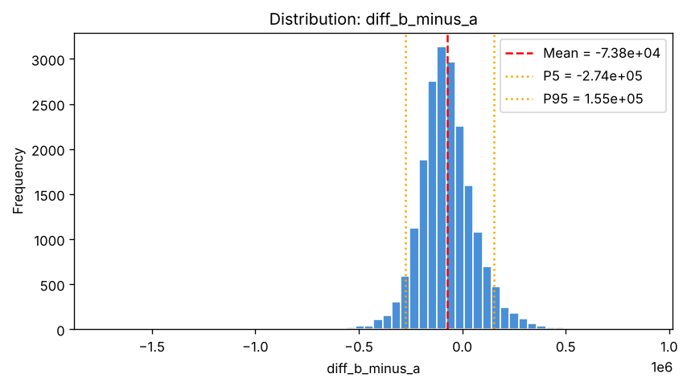
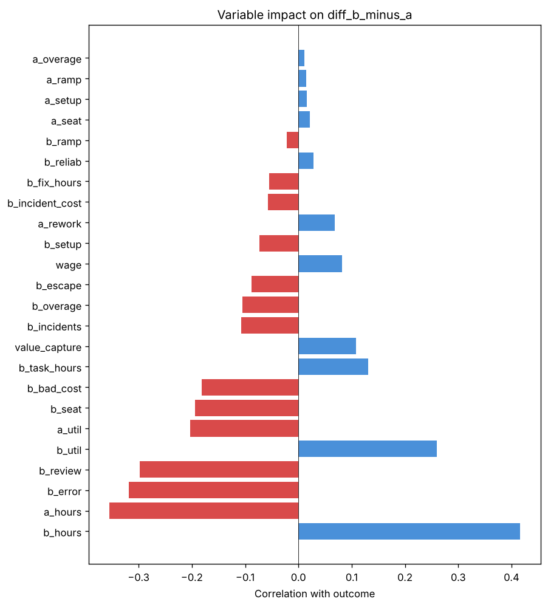
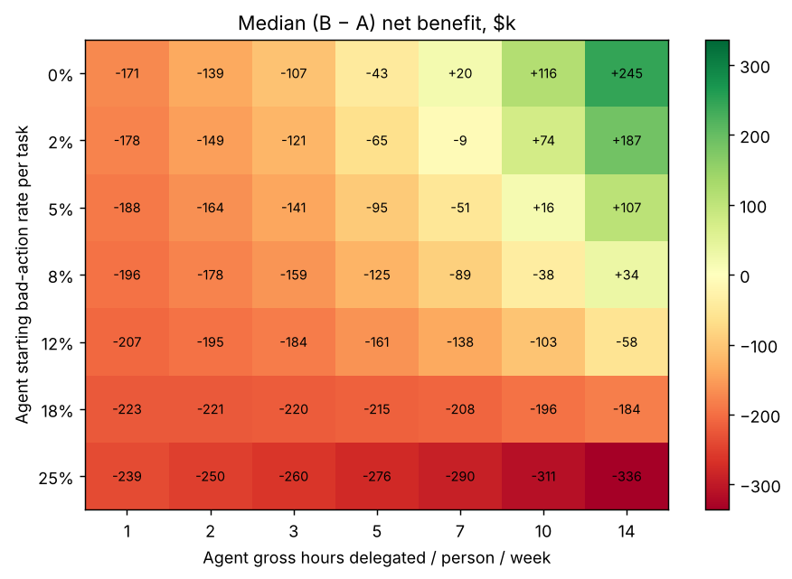

# Agentic OS vs AI OS — Monte Carlo trade-off (25 people × 24 months)

**Bottom line:** under the stated assumptions, **the AI OS path (A) beats the Agentic OS path (B) about 75% of the time.** A is cheap and almost never loses money (P(net > 0) = 97.5%). B has the higher ceiling (P95 +$256k vs +$229k) but a real downside (P5 −$145k). It is a coin-flip to make any money at all (P(net > 0) = 51.5%). **If the rollout hits 70% seat use and keeps review at 30% of delegated time**, B becomes a *better than 70% bet* at **≥ 7 hrs/person/week delegated at a ~2% bad-action rate**, or ≥ 10 hrs/week at ~5%. At 10% errors it needs higher use and lighter review (≥ 12 hrs/wk at 80% use and 20% review ≈ 74%). Under the default, less disciplined assumptions, 7 hrs at 2% is only 46%.

> Produced by `skills/monte-carlo-predictor/examples/agentic_vs_ai_os.py` using this repo's engine (`engine.simulate_with_samples`): 20,000 trials, seed 42. Additional runs: a 7×7 sensitivity sweep and a 36-cell gate table at 10,000 trials per cell, plus a pilot scenario — about 0.9M trials in total. The router (`prediction-toolkit`: `python -m engine router recommend`) picked **Simulation (Monte Carlo)** as its top method. Its match was weak (score 0.053, matched only on "uncertainty"), so treat the routing as a confirmation, not strong evidence.
>
> **Revision note:** two rounds of independent cold review drove this version. Round 1 found that the error rate barely mattered, the controls never tested it, calendar weeks were used instead of working weeks, and the pilot and gate claims went beyond what the model had run. Round 2 found horizon bugs in the short-pilot formulas and gate claims missing their conditions. All important findings are fixed; section 5 lists each one.

---

## 1. Results

### Headline (24-month totals, USD, 25 people, 46 working weeks/year)

| Outcome | P5 | P50 | Mean | P95 |
|---|---:|---:|---:|---:|
| A cost | $17k | $21k | $21k | $26k |
| A productivity value | $29k | $102k | $116k | $250k |
| **A net benefit** | **$8k** | **$81k** | **$95k** | **$229k** |
| B cost | $86k | $143k | $156k | $266k |
| B productivity value | $39k | $150k | $177k | $407k |
| **B net benefit** | **−$145k** | **$4k** | **$21k** | **$256k** |
| **B − A** (paired) | −$274k | −$81k | −$74k | +$155k |

| Probability | Value |
|---|---:|
| **P(B beats A)** | **0.250** |
| P(A net > 0) | 0.975 |
| P(B net > 0) | 0.515 |

**Stability.** P(B beats A) came out at 0.250 (seed 42, 20k trials), 0.246 (seed 7, 20k), 0.247 (seed 123, 50k) and 0.247 (seed 2026, 100k). The median of B − A ranged from −$80.3k to −$81.9k across those runs. Sampling error (~±0.3 pts) is negligible next to the **assumption** uncertainty in section 4.




### Tornado — what drives B − A

Pearson correlation of each input with (B − A), from the engine's tornado:

| Rank | Variable | Corr. | Reading |
|---:|---|---:|---|
| 1 | `b_hours`: work delegated to the agent per person per week | **+0.42** | The main driver |
| 2 | `a_hours`: ambient-assistant hours saved per person per week | −0.35 | The better A works, the less B adds |
| 3 | `b_error`: starting bad-action rate per task | **−0.32** | Failed tasks deliver nothing and cost fixes or damage |
| 4 | `b_review`: review time as a share of delegated hours | −0.30 | Review overhead is a real tax |
| 5 | `b_util`: share of agent seats actually used | +0.26 | Idle agent seats are expensive |
| 6 | `a_util` | −0.20 | |
| 7 | `b_seat`: agent seat price | −0.19 | Price matters less than how much the agent is used |
| 8 | `b_bad_cost`: $ cost per bad action that slips past review | −0.18 | |
| 9 | `b_task_hours`: size of each delegated task | +0.13 | Partly a modelling artefact: fix time and escape cost are per task, regardless of task size |
| 10 | `value_capture` | +0.11 | |



Per-path charts: [net A histogram](agentic-vs-ai-os-mc/histogram_net_a.png) · [net A tornado](agentic-vs-ai-os-mc/tornado_net_a.png) · [net B histogram](agentic-vs-ai-os-mc/histogram_net_b.png) · [net B tornado](agentic-vs-ai-os-mc/tornado_net_b.png)

### Sensitivity sweep — agent error rate × hours delegated

Both variables are pinned to each grid value. Everything else, including seat use and review share, stays uncertain at its default prior.

**P(B beats A)**

| error \ hrs/wk | 1 | 2 | 3 | 5 | 7 | 10 | 14 |
|---|---:|---:|---:|---:|---:|---:|---:|
| 0% | 0% | 1% | 6% | 31% | 57% | 80% | 92% |
| 2% | 0% | 0% | 4% | 22% | 46% | 71% | 87% |
| 5% | 0% | 0% | 2% | 13% | 31% | 55% | 73% |
| 8% | 0% | 0% | 1% | 8% | 20% | 40% | 57% |
| 12% | 0% | 0% | 0% | 4% | 11% | 24% | 39% |
| 18% | 0% | 0% | 0% | 1% | 4% | 10% | 19% |
| 25% | 0% | 0% | 0% | 0% | 1% | 3% | 7% |




**Reading it:** at 3 hrs/week or less, B wins at most ~6% of the time. Above a ~12% error rate, B stays below 40% across the grid. Error rate and hours delegated matter about equally, and you need both.

### Scale-up gates (what the pilot must show)

This table pins seat use at **70%** and review at **30%**, the targets a well-run rollout should hit, and varies hours delegated and error rate.

| Error rate | Hours/person/wk for P(B beats A) ≥ 70% | P at 7 hrs | P at 10 hrs |
|---|---:|---:|---:|
| 2% | **7** | 71% | 93% |
| 5% | **10** (9 h = 69%) | 48% | 77% |
| 10% | **not reached by 16 h** (16 h = 68%) | 21% | 43% |

### Pilot economics

| Scenario | B cost P50 | B net P5 / P50 / P95 | P(B net > 0) |
|---|---:|---:|---:|
| Pilot: 5 people × 3 months, full setup-cost range | $29k | −$50k / −$28k / −$12k | 0.000 |
| 5 people × 24 months (never scaled up) | — | median −$20k | 0.221 (P(B beats A) = 0.109) |

**A pilot does not pay for itself.** It is an **information purchase: cash outlay P50 ≈ $29k, net cost P50 ≈ $28k (P5–P95 $12k–$50k)**. Most of that is the fixed setup cost. Staying small permanently is the worst option: B at 5 seats loses money ~78% of the time.

---

## 2. Model

Both paths sit in **one spec**, so every trial uses the same draw of the shared inputs (`wage`, `value_capture`). That makes it a paired comparison, and P(B beats A) is a genuine head-to-head.

```
weeks  = 24/12 × 46 = 92 working weeks        adoption avg = 1 − R/(2T) if R ≤ T else T/(2R)
A value = 25·92·adoptA·utilA·max(hoursA − reworkA, 0) · wage · value_capture
A cost  = 25·24·(seatA + overageA) + setupA

usageB  = adoptB·utilB          gross = 25·92·usageB·hoursB          tasks = gross / task_hours
err     = errorB·(1 − gain·min(T/24,1)/2)       bad = tasks·err        escaped = bad·escape
B hours = gross·(1 − err)  − gross·review  − (bad − escaped)·fix_hours
          (bad tasks deliver nothing; all delegated work is reviewed; caught bad tasks cost fix time)
incidents = poisson(0.3) · min(T/24,1) · (team/25) · (usageB/0.5) · (errorB/0.05)
B cost  = 25·24·seatB + 25·24·usageB·overageB + setupB + escaped·bad_cost + incidents·incident_cost
B value = B hours · wage · value_capture
```

### Assumptions (every input is an assumption — none measured for a specific team)

| Variable | Distribution | Range / mean | Rationale |
|---|---|---|---|
| Working weeks | constant | 46 / yr | 52 less holidays, PTO, sick days |
| `wage` (loaded $/hr) | triangular | 45 / 65 / 110 | Houston-type professional services, fully loaded |
| `value_capture` | beta(6,4) | mean 0.60 | Saved hours don't all become value; shared by A and B |
| `a_seat` $/seat/mo | triangular | 18 / 25 / 35 | Ambient-assistant tier list prices, **not verified this session** |
| `a_overage` | uniform | 0–5 | Ambient tools rarely meter usage |
| `a_setup` | triangular | 1k / 3k / 8k | Licensing, light training |
| `a_hours` hrs/person/wk | triangular | 0.5 / 2 / 4.5 | Drafting, summarising, search; the human still executes |
| `a_rework` | triangular | 0.05 / 0.25 / 0.7 | The human catches most assistant errors inline |
| `a_ramp` months | triangular | 1 / 2 / 4 | Bundled into tools people already use |
| `a_util` | beta(6,4) | mean 0.60 | Many ambient seats go lightly used |
| `b_seat` $/seat/mo | triangular | 40 / 100 / 250 | Pro/Max/agent tiers up to Devin-class, **not verified this session** |
| `b_overage` $/active seat/mo | lognormal(μ=3.69, σ=0.8) | median ≈ $40, P95 ≈ $150 | Token/usage overage, long tail |
| `b_setup` | triangular | 5k / 20k / 60k | Integrations, guardrails, permissions, training |
| `b_hours` hrs/person/wk | triangular | 1 / 5 / 12 | Gross work delegated once adopted |
| `b_task_hours` | triangular | 0.15 / 0.35 / 1.0 | Human-hours of work in one delegated task |
| `b_review` | beta(3,7) | mean 0.30 | Review time as a share of delegated hours |
| `b_error` per task | beta(2,38) | mean 0.05 | Starting bad-action rate |
| `b_reliab` | uniform | 0.1–0.6 | Error-rate reduction by month 24 |
| `b_escape` | beta(2,8) | mean 0.20 | Share of bad actions that get past review |
| `b_fix_hours` | triangular | 0.25 / 0.5 / 2 | Fixing a bad action that review caught |
| `b_bad_cost` | lognormal(μ=5.0, σ=0.8) | median ≈ $150 | Team-average $ per escaped bad action |
| `b_incidents` | poisson(λ=0.3) | baseline per 24 mo | Major incident; scaled by team, usage and error rate |
| `b_incident_cost` | lognormal(μ=9.6, σ=1.0) | median ≈ $15k | Fat tail |
| `b_ramp` months | triangular | 2 / 4 / 9 | Workflow redesign takes longer |
| `b_util` | beta(5,4) | mean 0.56 | Agent use tends to be uneven across a team |

### Negative controls (run on every invocation; the script exits non-zero on failure)

All pinned values sit inside the priors. In the two error-rate controls, hours, seat use and review are held at favourable values, so only the error rate can change the outcome.

| Known input | Required | Result |
|---|---|---:|
| 12 hrs/wk, 80% use, 20% review, **0% errors** | B must win (P > 0.95) | 0.999 ✅ |
| Same, but **40% bad-action rate** | B must lose (P < 0.05) | 0.011 ✅ |
| Agent saves 0 hours | B must lose (P < 0.01) | 0.000 ✅ |
| 7 hrs/wk, 80% use, 20% review; error 0% → 5% → 12% → 25% | P falls strictly, by > 30 pts | 0.96 → 0.73 → 0.33 → 0.04 ✅ |

In v1, the second control would have **failed**: B still won 59% of trials at a 40% error rate. That was the evidence the error mechanics were wrong, and it drove the restructure. **Limit:** if every error-cost input is pinned at its mildest prior bound (every error caught, 0.25 h fixes, 1-hour tasks, no incidents), even a 40%-wrong agent wins ~87%. The control proves the error rate matters under typical costs, not under every combination.

---

## 3. Recommendation (plain language)

1. **Roll out the AI OS path to all 25 people.** It costs ~$21k over 24 months and pays back in ~97% of trials.
2. **Only run an Agentic pilot if the team has real, delegable multi-step work.** Budget it as an **information purchase: ~$29k outlay, ~$28k net cost** (5 people × 3 months; P5–P95 net −$50k to −$12k). Keep setup lean, because setup is most of the pilot's cost.
3. **Do not stop at a small permanent agent group.** At 5 seats for 24 months, B loses money 78% of the time. Either scale on evidence or shut it down.
4. **Scale to the team only if the pilot measures all of these:**
   - **seat use ≥ 70%** and **review ≤ 30%** of delegated time. The hour gates below assume both; without them, the gates do not hold;
   - **≥ 7 hrs/person/week delegated at ≤ 2% bad-action rate**, or ≥ 10 hrs/week at ≤ 5% (each gives ≈ 70% chance B beats A);
   - at **~10% bad actions**, scaling needs ≥ 12 hrs/week **and** ≥ 80% use with ≤ 20% review (≈ 74%); at 12% that drops to ≈ 64%. Treat 10%+ as a stop unless usage is exceptional.
5. **Re-run this script with the pilot's measured values** in place of the priors before committing to 25 seats.

---

## 4. Caveats (honest limits)

- **Every input is an assumption.** No input is fitted to data from a real team. Vendor prices are ranges as understood, **not verified against vendor pages in this session**. The intervals above describe *the model under these assumptions*, not reality.
- **Inputs are sampled independently.** In reality several move together:
  - `a_hours` and `b_hours` both depend on how delegable the work is. Linking them would probably narrow the B − A spread.
  - `b_hours`, `b_util` and `b_review` probably move together, because teams that use agents more also learn to review faster.
  - The net effect on P(B beats A) was **not tested**. The engine has no correlated sampling.
- **`value_capture` is the softest number.** It scales both paths. If saved hours don't become billable or higher-value work, both shrink, and A's low cost matters even more.
- **Linear ramps and a linear reliability gain** are simplifications. The error-rate average ignores that usage rises later in the horizon, when errors are lower, so it slightly overstates errors. A step change in agent reliability is not modelled.
- **Fix time and escape cost are per task**, whatever the task's size. That flatters large tasks (task size correlates +0.13 with B − A).
- **`b_bad_cost` is a team-average cost per escaped action**, drawn once per trial. It represents uncertainty about that average, not the spread between individual actions.
- **Incident scaling is linear in expectation.** The Poisson count is multiplied by horizon, team, usage and starting-error ratios. That gets the expected count right, but ~74% of trials still have zero incidents whatever the error rate.
- **Setup cost is fixed regardless of team size.** That is why small deployments look so bad. A lighter setup for a pilot would lower its cost.
- **Not modelled:**
  - running A and B together (the realistic end state);
  - compounding skill gains, attrition and hiring effects;
  - vendor lock-in;
  - regulatory or confidentiality exposure from agents acting on client data, which can dominate in legal and CPA work.
- **The tornado measures linear correlation.** It ranks influence well here but understates interactions. That is why the sweep and gate table exist.

---

## 5. Review log

Two independent cold reviews were run by a separate Claude agent, given only the files and asked what was wrong. Round 2 also spot-checked 30 numbers in this document against `results.json`; all matched. It is the **same model family**, so this is not a cross-family check. Findings and what changed:

| # | Finding (severity) | Resolution |
|---|---|---|
| 1 | Error rate barely mattered: task count wasn't tied to hours, and failed tasks still counted as saved (important) | Tasks = hours ÷ task size; bad tasks deliver nothing; incidents scale with usage and error rate. Error rate is now the #3 driver (corr −0.31) |
| 2 | Negative controls never tested the error rate; the "known-good" control pinned 15 hrs, above the prior (important) | Added a 40%-error control and an error-monotonicity control, both with error as the only adverse input; all pins are within the priors |
| 3 | Counted 104 calendar weeks, not working weeks (important) | 46 working weeks/yr → 92 weeks. P(B beats A) went 0.297 → 0.252 |
| 4 | Recommended a 3–5 person pilot the model never ran (important) | Pilot simulated explicitly and reframed as a ~$27k information purchase |
| 5 | "Scale" gates were break-even points (P ≈ 50%), not wins (important) | Gate table with use 70% and review 30% pinned; gates set at P ≥ 70% |
| 6 | Overage ignored the adoption ramp (nit) | Overage scaled by adoption × use |
| 7–10 | Error averaging, correlation caveat, wording, sweep pairing (nits) | Caveats rewritten; wording fixed; sweep pairing noted below |
| **Round 2** | | |
| N1 | Adoption formula wrong when the ramp outlasts the horizon; 3-month pilot adoption inflated ~1.5× (important) | Exact piecewise average; verified against the closed form to 0.0 max error at 3 and 24 months |
| N2 | Pilot incident rate not scaled to the horizon, ~8× too high (important) | × min(T/24, 1) |
| N3 | Pilot got the full 24-month reliability gain (nit) | Gain × min(T/24, 1) |
| N4 | Gate claims stated without the 70%-use/30%-review conditions; "10% = stop at any usage" contradicted by in-prior probes (important) | Conditions stated in the bottom line and the recommendation; 10% claim replaced with the probed numbers (74% / 64%) |
| N5 | Per-task fix and escape cost don't scale with task size (nit) | Caveat added; tornado reading corrected |
| N6 | Incident reference compared against the reliability-reduced rate (nit) | Now scales by the starting error rate |
| N7 | Pilot cost quoted as both $27k and $30k (nit) | Outlay and net cost quoted separately |
| — | Round 2 verdicts on v1 findings | 1, 2, 3, 6, 8, 9, 10 FIXED; 4, 5 PARTIAL until N1–N4 fixed; 7 accepted as a caveat |

The sweep and gate cells share a seed with each other but are **not** draw-for-draw paired with the base run, because pinning variables shifts the random stream. Cells are comparable with each other; compare them with the base case only loosely.

## Reproduce

```bash
cd skills/monte-carlo-predictor
python3 examples/agentic_vs_ai_os.py              # ~14 s; writes charts + spec.json + results.json
python3 examples/agentic_vs_ai_os.py --selfcheck  # negative controls only
python3 -m engine.tests.test_engine               # engine tests (15/15 passing)
```

The full spec is in [`agentic-vs-ai-os-mc/spec.json`](agentic-vs-ai-os-mc/spec.json) and the raw report, sweep, gate table and pilot runs are in [`agentic-vs-ai-os-mc/results.json`](agentic-vs-ai-os-mc/results.json).
